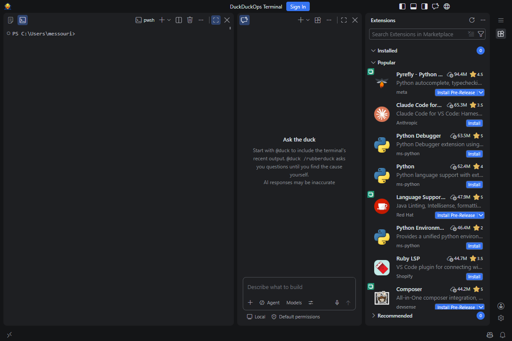
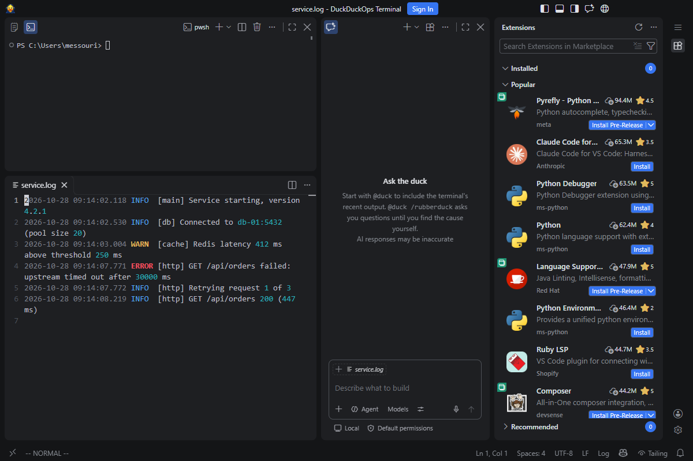
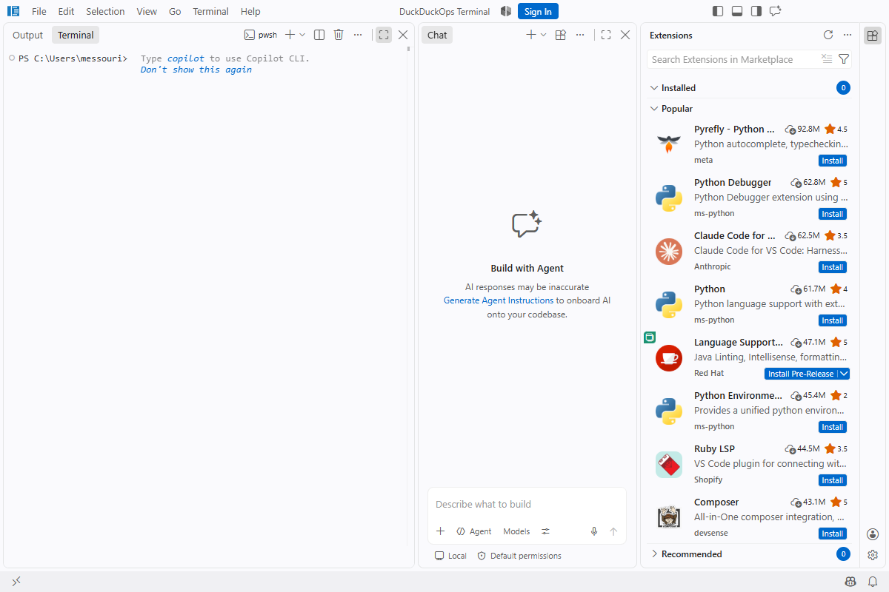
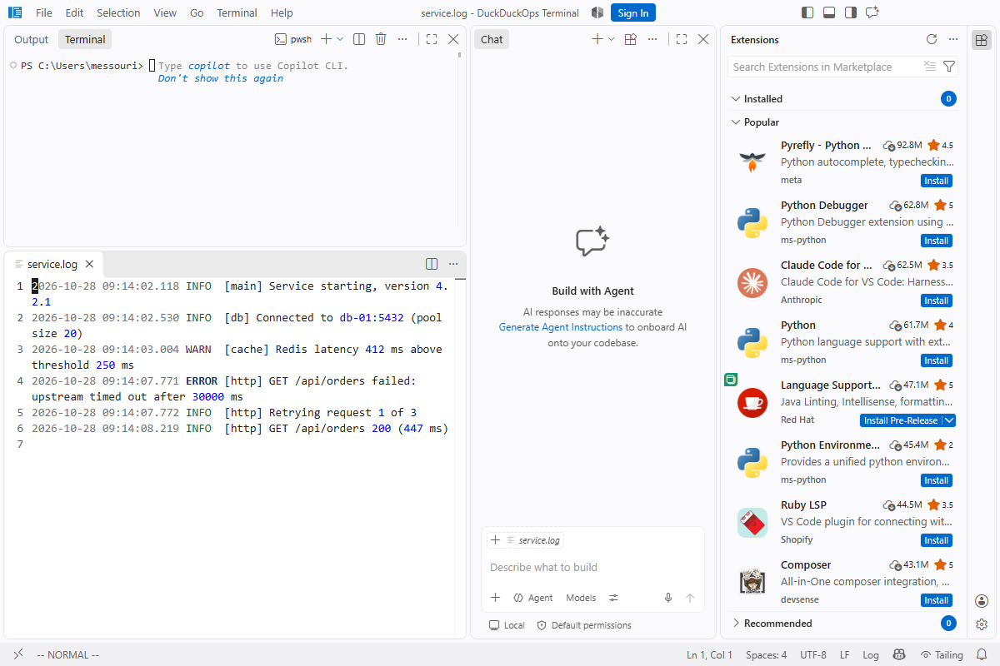

# Changelog

Each release on GitHub uses the matching section below as its notes. Every version needs one: the build fails without it.
Write for someone deciding whether to update: what is new, what changed, what to do after updating.
For each release, take screenshots of the build (`node build/ddo/smoke.ts <app folder> docs/screenshots/<version>`, or the `ddo-smoke` artifact of the branch's build), keep `desktop-terminal.png` and `desktop-file.png` plus any screen that changed, and show them as in the sections below.

## [0.7.1] - Terminal extras

A friendlier start for every terminal, and recordings of your terminal sessions you can replay.

| On startup (0.4.0, until 0.7.1 screenshots are taken) | With a log open (0.4.0) |
|---|---|
|  |  |

### New
- **A welcome in each new terminal**: the date and the weather, then an ops joke or, now and then, a DuckDuckOps tip. The lines are only shown, never sent to the shell; terminals for tasks, Copilot's own and SSH sessions start without them.
- **Record a terminal**: **Record Terminal** in the terminal's title bar (or its right-click menu) records what it shows; **REC** in the status bar shows the time, click it or **Stop Recording and Save** to save an asciinema `.cast` file: a few KB per minute, plain text you can read and edit.
- **Play Terminal Recording** replays a `.cast` in a terminal, at the same pace (long pauses shortened to 3 s): space pauses, `+` and `-` change the speed, `r` plays again, `q` closes. Also `asciinema play`, or asciinema.org.

### Things to know
- The weather comes from [wttr.in](https://wttr.in), which finds your city from your network address; set **DuckDuckOps > Terminal: Weather Location** to choose it, or remove `weather` from **Welcome Lines**. An empty **Welcome Lines** list turns the welcome off.
- A recording keeps everything the terminal shows, passwords, keys or tokens included if they appear. What you type is recorded only when the shell shows it. Check a recording before you share it.
- Recordings go to `.ddo\recordings` in your user folder unless you pick another place.

## [0.7.0] - Folder

A panel next to the terminal shows the folder you're in and follows everything you do there; new colour icons; and a second theme, Forge Hackerman.

| On startup (0.4.0, until 0.7.0 screenshots are taken) | With a log open (0.4.0) |
|---|---|
|  |  |

### New
- **Folder panel**, right of the terminal: the folder the terminal is in, with PowerShell, cmd, WSL or Git Bash. It follows `cd`, and it follows everything else too:
  - **listing commands** set how it shows the folder: hidden files (`ls -a`, `Get-ChildItem -Force`, `dir /a`), sizes and dates (`ls -l`), the order (`ls -t`, `-S`, `-X`, `-r`, `| Sort-Object LastWriteTime`, `dir /o:-d`), a pattern (`ls *.log`) or another folder (`ls /var/log`);
  - **after any command** (`git pull`, `tar -x`, `rm`, a script...) it marks what was **new**, **changed** or **deleted**, and the files the command named. It updates while a long command runs.
  - **Double-click a folder** to `cd` there in the terminal; **click a file** to open it above the terminal. Drag a file onto the terminal to type its path; right-click to copy its path or show it in File Explorer.
- **Forge Icons**: colour icons for files and folders (logs, configs, scripts, keys and certificates, archives, Docker, Terraform, `.git`, `.ssh`...), from [Phosphor](https://phosphoricons.com). The activity bar's icons are Phosphor's two-tone icons.
- **Forge Hackerman Dark and Light**: phosphor green on black, or deep green on mint, with a green terminal.
- **DuckDuckOps: Choose Theme** in the Command Palette: Forge or Forge Hackerman, light, dark, or **like Windows** (light by day, dark at night, with your Windows setting).
- **A new icon**: the pixel-art duck with its headset, on the app, the taskbar, the Start menu and the installer.
- **The terminal is at the bottom**, with the folder panel: files, logs, web pages and Markdown previews open above it, and the area closes with the last tab.
- **The duck as the chat pet** (a first version of its pictures): **DuckDuckOps: Show or Hide the Duck** in the Command Palette, or `/vscode-pet` in the chat. It sleeps, wakes up, types along with you, thinks while Copilot answers and worries when something goes wrong.

### Things to know
- The folder panel needs the terminal's shell integration, on by default, to follow `cd` and commands. In a terminal connected over SSH it shows nothing: the files are on the other computer.
- Hide the panel by right-clicking its title, or drag the line between it and the terminal to resize it.
- If you picked another file icon theme before, it stays: pick **Forge Icons** under **File Icon Theme** in the Command Palette.
- If your terminal was above the files, it moves to the bottom once. To put it back on top, right-click its title and pick **Panel Position**.

### After updating
- Run a few commands in the terminal (`ls -la`, `cd ..`, `git pull`) and watch the folder panel.

## [0.6.0] - Duo

Several chats on different models, one above the other, that pass their answers to each other; and the duck now speaks up when a command fails.

| On startup (0.4.0, until 0.6.0 screenshots are taken) | With a log open (0.4.0) |
|---|---|
|  |  |

### New
- **Duo: up to three chats in the chat column**, one above the other. **Add Chat** in the chat's title opens another; each one has its own conversation, model and agent. For example: Chat 1 on Sonnet investigates in the terminal, Chat 2 on Opus or GPT checks each step.
- **Let the Chats Talk**: each finished answer goes to the next chat, which checks it or takes the next step, in turn. They stop when one says the task is DONE, after 6 answers (`ddo.duo.maxTurns`), or with **Stop**. You can read and type in every chat while they talk.
- **Ask the duck when a command fails**: after a failed command, **Ask the duck** shows in the status bar for two minutes; it asks `@duck` about that command and its output.
- **Ask the Duck** in the terminal's right-click menu asks about the selected text.
- **`@duck /summary`** writes an incident summary of your terminal session: timeline with times, cause, what was changed, open points. **Open as Markdown** turns it into a document for a ticket.
- **Copilot CLI is back**: in the chat's session target you can pick **Copilot CLI** or **Copilot** (the Copilot harness) instead of **Local**. Their sessions keep running when the window closes, they use your MCP servers and the Duck agents, and your organization's Copilot sandbox and permission rules apply.
- **`copilot` in the terminal** starts GitHub Copilot CLI, as in VS Code. If it isn't installed, it shows where to get it and asks before installing it; the installer can also install it for you.

### Things to know
- Every answer in every chat is a Copilot request, and premium models count more. Talking chats use several requests per question.
- New chats still start on the **Local** harness, where `@duck` runs. `@duck` is not available in Copilot CLI and Copilot chats.
- The installers add the `copilot` command to the PATH next to `ddo`, unless you clear **Add to PATH** or pick otherwise on the Copilot CLI page. IT can leave it out, see the deployment notes.
- The app is about 260 MB bigger again (880 MB installed instead of 620), for the Copilot CLI runtime and the Copilot harness (the Agent Host).

### After updating
- Open a second chat with **Add Chat** (the split icon in the chat's title), pick a model in each, ask in the first one, then **Let the Chats Talk**.

## [0.5.0] - Sessions

Your servers in a list, like in MobaXterm: one click opens SSH, a tunnel or Remote Desktop, and every connection is saved.

| On startup (0.4.0, until 0.5.0 screenshots are taken) | With a log open (0.4.0) |
|---|---|
|  |  |

### New
- **Sessions**, in the right side bar: SSH, SSH tunnels, Remote Desktop and local shells, in folders. Click one to connect.
- **Your MobaXterm and PuTTY sessions are listed automatically**, with their folders, next to the hosts of your `~/.ssh/config`. They are read live, so changes made in MobaXterm or PuTTY show up; **Copy to My Sessions** makes one editable in DuckDuckOps.
- **SSH the way ops needs it**: jump host, SOCKS5 or HTTP proxy, port forwarding (local, remote, SOCKS), key file, keep-alive and a start folder, with Windows' own OpenSSH client.
- **Tunnels** start and stop from the list; the icon turns green while one runs.
- **Every connection is saved.** Quick Connect and `ssh` commands typed in a terminal land under **Recent** (the last 20).
- **Import from MobaXterm** (`MobaXterm.ini` or exported `.mxtsessions`: SSH and Remote Desktop) **and PuTTY** (SSH, with proxy and port forwarding), to keep them in DuckDuckOps for good.
- **Each session has a colour**: a border around its terminal, its tab and its icon. New sessions get one at random; production sessions are always red. `ddo.sessions.colorStyle` switches to a tinted background, or off.
- **Session logs**: a session can save its output to a file (`ddo.sessions.logOutput`, or per session).
- **Team sessions**: read-only session files, for example on a network share (`ddo.sessions.teamFiles`).
- **The terminal opens in WSL** when a distribution is installed, otherwise in PowerShell 7, otherwise in Windows PowerShell (`ddo.terminal.defaultShell`).
- **Update check**: DuckDuckOps tells you when a new release is out, and **DuckDuckOps: Check for Updates** checks now.
- **Recommended Extensions for Ops**: PowerShell, YAML, Docker, Kubernetes, Ansible, Terraform and more from Open VSX, offered once on the first start.

### Things to know
- Passwords are never saved or imported. SSH asks for them in the terminal; keys and `ssh-agent` work as usual.
- Proxies without authentication only, and a session uses either a jump host or a proxy, not both.
- From MobaXterm only SSH and Remote Desktop sessions are imported, without their SSH gateway. PuTTY keys (`.ppk`) need converting to OpenSSH format with PuTTYgen.
- X11 forwarding needs an X server, which DuckDuckOps does not include.
- The update check asks GitHub (`api.github.com`) once a day; turn it off with `ddo.updates.check`.
- Sessions are kept in `.ddo\sessions.json` in your user folder. **Edit Session** opens it at the session, with completion and checks.

### After updating
- Sessions opens in the right side bar on the first start, with your MobaXterm and PuTTY sessions if you have any. A portable MobaXterm needs its `MobaXterm.ini` in `ddo.sessions.mobaXtermFile`; `ddo.sessions.listFrom` chooses which are listed.
- If you chose a default terminal profile yourself, it is kept.

## [0.4.1] - Ready for managed devices

On work laptops with application control, the installer of 0.4.0 can be "blocked by your system administrator". This release gives IT what it needs to deploy DuckDuckOps.

### New
- **An all-users installer**, `DuckDuckOps-Terminal-SystemSetup-x64-0.4.1.exe`. It installs into Program Files, which application control usually allows, and IT can deploy it silently (Intune, SCCM).
- **`SHA256SUMS.txt`** in every release, with the hash of each file.
- **[Deployment notes for IT](https://github.com/acathon/duckduckops-terminal/blob/main/docs/it-deployment.md)**: silent install and uninstall, detection rule, what DuckDuckOps connects to and where it keeps its data.

### Things to know
- On a managed laptop, ask your IT to deploy the all-users installer. Send them the link to the deployment notes.
- The files are still not code-signed. Until they are, IT allows DuckDuckOps by its install folder or by file hash.
- Nothing changes in the app itself.

### After updating
- If 0.4.0 installed fine for you, nothing to do. The per-user installer is still there.

## [0.4.0] - Duck agents

Three Copilot agents that work together on an ops task, each on its own model, sharing your terminal.

| On startup | With a log open |
|---|---|
|  |  |

### New
- **Duck Lead, Duck Operator and Duck Reviewer**, in the chat's agent list. The Lead plans and hands each step to the Operator, which runs it in the terminal; before anything that changes the system, the Reviewer checks it. Buttons under an answer pass the work from one to another by hand.
- **Each agent has its own model.** The first time Copilot is signed in, DuckDuckOps picks one per agent from the models your Copilot plan offers (for example Opus for the Lead, Sonnet for the Operator, GPT for the Reviewer) and tells you which. Change them, or leave an agent out, with **DuckDuckOps: Set Up Agents**.
- **The terminal is shared.** The agents read what you ran before they start, and the commands they run show in the terminal, not only in the chat.
- **Safer commands.** Diagnostics such as `systemctl status`, `journalctl`, `kubectl get`, `ipconfig /all` or `Test-NetConnection` run without asking. Restarting or stopping services, rebooting, `kubectl delete`, `terraform apply`, `helm upgrade` and `docker rm` always ask first, whatever else you allowed.
- **Fewer tokens.** Each agent gets only the tools its job needs, and an agent that fails twice the same way stops and asks the Reviewer instead of trying again (ideas from Microsoft's TokenEconomizer).

### Things to know
- Every agent turn uses a Copilot request, and premium models such as Opus count more. With three agents on one task, keep an eye on your Copilot usage.
- Which models you can pick depends on your company's Copilot plan and policies.
- The agents live in `.ddo\agents` in your user folder as `.agent.md` files. You can read and edit them; **Set Up Agents** writes them again.

### After updating
- Sign in to GitHub Copilot if you haven't. A message tells you when the agents are ready; pick **Duck Lead** in the chat to start.

## [0.3.0] - Forge themes and a lighter app

Two themes of its own, more space between the parts, and about 110 MB less to download and install.

### New
- **Forge Light and Forge Dark**, calm themes in the style of JetBrains IDEs: the terminal, the chat and the side bar are white (or dark grey) cards on a grey frame, with blue accents, readable log colours (errors red, warnings orange, dates grey) and matching terminal colours. They follow the Windows light or dark mode.
- **More space between the parts**: the gaps are twice as wide as in VS Code, so each part reads as its own card.
- **The integrated browser** has a globe button in the title bar.
- **The menu is a button** at the top of the activity bar instead of a menu bar, and the terminal and chat titles show icons instead of TERMINAL and CHAT.

### Things to know
- **Fewer themes.** Forge Light, Forge Dark, Light 2026, Dark 2026 and the two High Contrast themes remain. If you picked Dark+, Light+, Dark Modern, Light Modern or a Visual Studio theme, you get the default theme again.
- **No Agents window.** "Open in Agents" buttons and commands are gone; it needed the Copilot CLI runtime, which DuckDuckOps does not ship. Copilot Chat next to the terminal works as before, including agent mode.
- **Smaller app**: Chromium's own strings are in English and French only (menus and dialogs of DuckDuckOps are not affected), and parts DuckDuckOps never loaded are no longer included.
- To get the menu bar back, set `window.menuBarVisibility` to `classic`. To pick another theme: **Preferences: Color Theme**.

### After updating
- Your settings override the new defaults: if you changed the menu bar or the theme before, those stay as you set them.

## [0.2.0] - The duck, and an installer

DuckDuckOps now looks like itself: the duck is the app icon, and it answers in the chat as `@duck`. It can also be installed like any Windows app.

### New
- **`@duck` in the chat** reads the terminal's recent output, as `@ops` did: `/explain`, `/fix`, `/logs`.
- **`@duck /rubberduck`** talks a problem through with you: the duck asks one question at a time and lets you find the cause. Ask it directly and it answers.
- **The duck as the app icon**, on the taskbar, the Start menu tile and the title bar.
- **The empty chat page** says how `@duck` works.
- **About** (Help menu) shows the DuckDuckOps version, then the VS Code version it is built on.
- **An installer**, `DuckDuckOps-Terminal-Setup-x64-<version>.exe`, next to the zip. It installs DuckDuckOps for your Windows account in `%LOCALAPPDATA%\Programs\DuckDuckOps` without administrator rights, adds it to the Start menu and `ddo` to your PATH, and can add a desktop icon and **Open with DuckDuckOps** to the Explorer menu (both off by default). Uninstall it from **Settings > Apps**.

### Things to know
- `@ops` is now `@duck`.
- The terminal no longer suggests typing `copilot`: the Copilot CLI is not part of DuckDuckOps.
- The chat's empty page no longer offers to generate agent instructions for a codebase.
- **The installer is not code-signed yet.** Windows SmartScreen may say "Windows protected your PC": choose **More info**, then **Run anyway**. Your company's IT may need to allow it.
- DuckDuckOps does not update itself. To update, run the new installer: it replaces the old version and keeps your settings.
- The zip is still there, for machines where you can't run installers.

### After updating
- Run the installer. If you used the zip of 0.1.1, delete the folder you extracted afterwards. Settings and extensions in `.ddo` in your user folder are kept.
- If the taskbar still shows the old icon, unpin DuckDuckOps and pin it again (Windows keeps icons in a cache).

## [0.1.1] - A terminal with Copilot next to it

The first release of DuckDuckOps Terminal: a workstation for IT/ops that opens on a terminal with GitHub Copilot Chat beside it, built from VS Code with the coding features taken out.

| On startup | With a log open |
|---|---|
|  |  |

### New
- **Terminal first.** The terminal fills the top left, Copilot Chat sits to its right, and the side bar (Extensions, Accounts) is on the far right next to a compact activity bar. Toggle each part from the title bar or with `Ctrl+B`.
- **Files, logs and web pages open below the terminal** as tabs, and that area disappears when the last one is closed.
- **Copilot Chat** in ask and agent mode, with tools and MCP servers. In chat, `@ops` sees your recent terminal output: `/explain`, `/fix`, `/logs`.
- **Extensions from Open VSX**, an internal gallery or VSIX files (**DuckDuckOps: Install VSIX Files from Internal Folder**).
- **Vim mode and the integrated browser** built in. The theme follows the Windows light or dark mode.
- Shortcuts with `Ctrl+Alt+`: **T** terminal, **C** chat, **O** open log, **K** clear terminal, **L** live tail, **N** terminal with profile, **A** ask chat about the selection.

### Things to know
- **Coding features are removed**, not hidden: Explorer, Search, Source Control, Debug, Testing, Problems, the welcome page, Settings Sync and Profiles are not in the app.
- **No Copilot CLI sessions.** Background Agent / Copilot CLI sessions and the Agent Host are left out, which saves about 100 MB. Chat and extensions that use the chat API work without them.
- Microsoft-only extensions (Remote-SSH, C#, Pylance, ...) are not on Open VSX and their licenses don't allow other apps. Open Remote - SSH is the Open VSX alternative.
- Settings and extensions are kept in `.ddo` in your user folder, separate from VS Code.

### Under the hood
- Built from microsoft/vscode `f3640a90889` (2026-10-24), with a reduced workbench in `src/vs/forge` and 25 of about 100 built-in extensions.
- Every build launches the app with a fresh profile and checks the layout before it can be released.

### After updating
- Download `DuckDuckOps-Terminal-win32-x64-0.1.1.zip`, extract it and run `DuckDuckOps.exe`. Sign in to GitHub from the Accounts menu to use Copilot.
