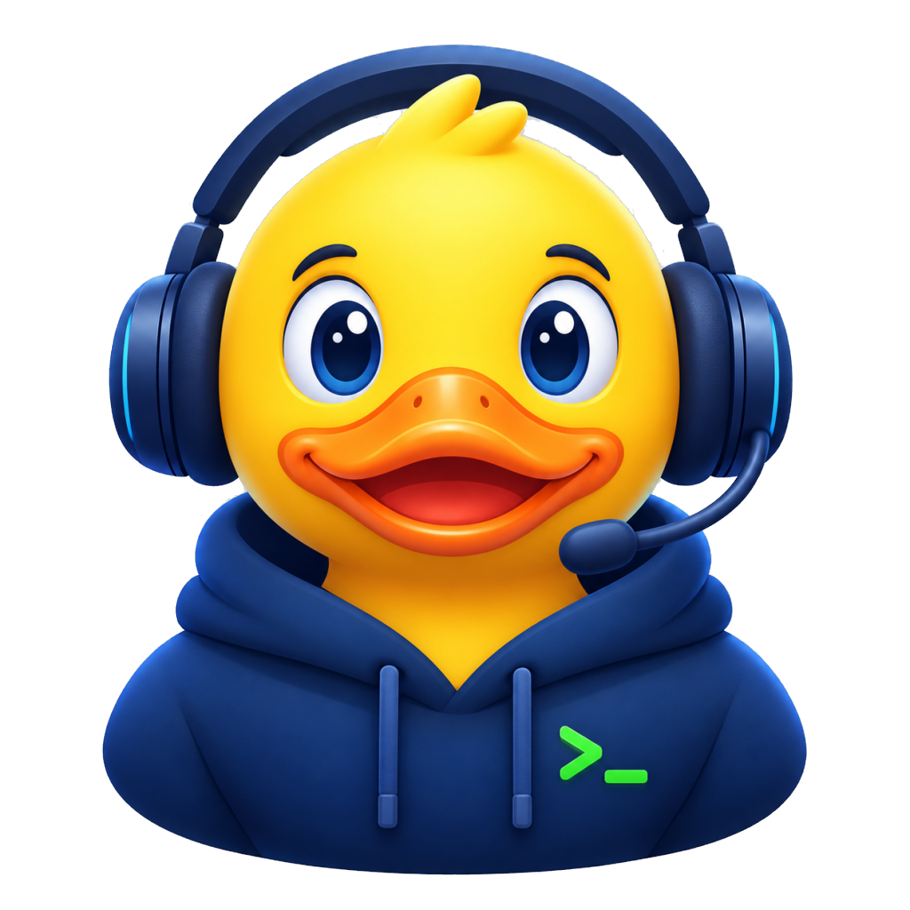

<p align="center"></p>

# DuckDuckOps Terminal

A terminal-first workstation for IT/ops, built on a VS Code (Code - OSS) fork. It opens on a
terminal with GitHub Copilot Chat next to it, your rubber duck for explaining what went wrong.
Coding features are removed. Extensions can be installed from Open VSX, an internal gallery or
VSIX files. Short name and command: `ddo`.

```
+----------------------+-----------+------------+----+
|       terminal       |           |            |    |
+----------------------+  Copilot  | Extensions | AB |
| files, logs, browser |   Chat    | (side bar) |    |
| (only while open)    |           |            |    |
+----------------------+-----------+------------+----+
```

- The area below the terminal appears when a file, log or web page (also one Copilot opens) is
  opened, as tabs, and disappears when the last one is closed.
- The first terminal of a window starts with the duck and how to reach the chat. It is printed
  before the shell starts and never sent to it. Turn it off with `ddo.terminal.greeting`.
- Parts have rounded corners (the "Modern UI" style). The theme follows the Windows light/dark mode
  (Light 2026 / Dark 2026).
- The side bar on the right is open at startup on Extensions. Switch views (Extensions, Accounts,
  Manage) from the compact activity bar, hide it with `Ctrl+B` or the toggle buttons in the title bar
  (which also toggle the terminal and the chat).

## What is in, what is out

The app loads its own workbench entry point, [`src/vs/forge`](src/vs/forge) (`vs/forge` is the
internal code name), when `product.json` has `"forge": { "enabled": true }`.

| Kept | Removed |
|---|---|
| Terminal, terminal suggestions, external terminal, tasks | Explorer view, Search view and editor, Source Control view |
| Copilot Chat, MCP servers, chat voice | Debug, Testing, Problems, Outline, Timeline, call/type hierarchy |
| Extensions view and install from gallery/VSIX | Merge editor, local history, bulk edit preview, Emmet, snippets UI |
| Settings, keybindings, themes, accounts, output/logs | Welcome page, walkthroughs, tours, surveys, Zen mode |
| Text editor (logs, Copilot diffs), multi-diff editor, Vim mode | Settings Sync, Profiles, Continue On, Remote Tunnels |
| Integrated browser and Copilot's browser tools, Simple Browser | Process explorer, language status, inline chat in the editor |
| Remote (for Open Remote - SSH etc.), accessibility | Copilot CLI runtime: Background Agent / Copilot CLI sessions, Agent Host |

How it is done:

- **Workbench features:** [`forge.common.main.ts`](src/vs/forge/forge.common.main.ts) and
  [`forge.desktop.main.ts`](src/vs/forge/forge.desktop.main.ts) are reduced copies of
  `workbench.common.main.ts` / `workbench.desktop.main.ts`. Where kept code still injects a service of a
  removed feature, a null service stands in (debug, testing, inline chat), as in the Agents window
  (`src/vs/sessions`).
- **Built-in extensions:** `forge.builtInExtensions` in [`product.json`](product.json) lists the 25 of
  ~100 folders under `extensions/` that are built, packaged and loaded (Copilot, GitHub sign-in, themes,
  JSON/settings support, Simple Browser, syntax colouring for ops file types). The build
  ([`build/lib/extensions.ts`](build/lib/extensions.ts), [`build/gulpfile.extensions.ts`](build/gulpfile.extensions.ts))
  and the extension scanner skip the rest. The list also names extensions downloaded at build time from
  `builtInExtensions` (VSCodeVim, from Open VSX with a pinned version and checksum); to update Vim, change
  its `version`, `sha256` and `metadata` there.
- **Copilot CLI runtime:** Copilot Chat (ask and agent mode, tools, MCP) and extensions that use the
  chat and language model APIs run in the extension host and don't need it. The build leaves out the
  Copilot CLI SDK (in the Copilot extension and the Agent Host's platform package, a few hundred MB),
  the Agent Host is never started and Background Agent sessions are turned off. To ship it again, set
  `"copilotRuntime": true` under `forge` in [`product.json`](product.json), e.g. when the GitHub org
  enforces Copilot sandbox or permission settings, which need the Agent Host.
- **Layout and defaults:** [`forge.contribution.ts`](src/vs/forge/browser/forge.contribution.ts),
  [`forgeWorkbench.ts`](src/vs/forge/browser/forgeWorkbench.ts) and the
  [`extensions/ddo`](extensions/ddo) extension.

After merging upstream, check that no kept code needs a service that DuckDuckOps no longer registers
(that fails at runtime with "unknown service"):

```bash
npm run transpile-client
node build/ddo/checkServices.ts
```

## Extensions

- **Open VSX** (public) is the default gallery in `product.json` (`extensionsGallery`). It has e.g.
  PowerShell, YAML, Docker, Open Remote - SSH and the language packs. Microsoft-only extensions
  (Remote-SSH, C#, Pylance, ...) are not there and their licenses do not allow other products.
- **Internal extensions:**
  - VSIX files: `ddo --install-extension ops-tools-1.2.0.vsix`, or set
    `ddo.extensions.vsixFolder` and run **DuckDuckOps: Install VSIX Files from Internal Folder**.
  - A self-hosted [Open VSX server](https://github.com/eclipse/openvsx) that hosts internal extensions
    and mirrors approved public ones. Point `extensionsGallery` in `product.json` at it (VS Code talks
    to one gallery at a time).
- **Allowlist:** the `extensions.allowed` setting (enforceable by policy) limits what can be installed,
  e.g. `{ "redhat": true, "ms-vscode.powershell": true, "yourcompany": true }`.

## Shortcuts
`Ctrl/Cmd+Alt+` **T** focus terminal · **C** focus chat · **O** open log · **K** clear terminal ·
**L** toggle tail · **N** terminal with profile · **A** ask chat about selection.
In chat, `@duck` sees recent terminal output (`/explain`, `/fix`, `/logs`). `@duck /rubberduck`
asks you questions instead of answering, until you find the cause yourself.

## Brand

The duck is [`resources/brand/duck.png`](resources/brand/duck.png). The app icon
(`resources/win32/code.ico`, the head alone at 32 px and below), the Start tiles, the Linux icon,
the installer images, the chat and title bar images and the terminal greeting (24 x 24 pixels in
half-block characters) are made from it.

## Build and run

Needs Node (version in `.nvmrc`), Python 3 and, on Windows, Visual Studio Build Tools 2022 with the
"Desktop development with C++" workload and the MSVC Spectre-mitigated libs (see
[How to Contribute](https://github.com/microsoft/vscode/wiki/How-to-Contribute) in the VS Code wiki).

```bash
npm ci
npm run watch            # or: npm run compile
./scripts/code.sh        # Windows: .\scripts\code.bat

npm run gulp vscode-win32-x64-min    # packaged app in ../VSCode-win32-x64 (also -darwin-arm64, -linux-x64)
```

**Without local build tools:** [`.github/workflows/release.yml`](.github/workflows/release.yml)
builds the Windows app on GitHub on every branch push and pull request. It keeps the app as a zip
and `ddo-smoke` (screenshots after first launch and after opening a file, layout checks, the
activity bar entries, renderer errors and logs, from [`build/ddo/smoke.ts`](build/ddo/smoke.ts))
as build artifacts, so a branch can be tried before it is merged.

## Branches and releases

- Work happens on `feat/<name>`, `fix/<name>` or `chore/<name>` branches (e.g. `feat/ssh-profiles`,
  `fix/startup-crash`, `chore/release-notes`), one commit per step, with the version in the subject
  of the commit that ships it: `SSH profiles (0.2.0)`.
- The version is `forge.version` in [`product.json`](product.json) (`version` there is the VS Code
  version that extensions check). A feature bumps the minor version, a fix the patch version.
- Every version has a section in [`CHANGELOG.md`](CHANGELOG.md) with screenshots in
  `docs/screenshots/<version>/`. The build fails without the section.
- Merging to `main` releases the version if it has no release yet: GitHub Release `ddo-<version>`
  with `DuckDuckOps-Terminal-win32-x64-<version>.zip` and the changelog section as its notes.
  Every merge also refreshes the notes of the released versions from the changelog.

```bash
# bump forge.version, add the CHANGELOG.md section and screenshots, commit, then
git switch main
git merge --ff-only feat/ssh-profiles
git push origin main
```

## Upstream

Based on [microsoft/vscode](https://github.com/microsoft/vscode) at commit `f3640a90889`
(2026-10-24). The repo history starts fresh at DuckDuckOps Terminal 0.1.1, so to merge a newer
upstream, graft that base in a local clone first:

```bash
git remote add upstream https://github.com/microsoft/vscode.git
git fetch upstream
git replace --graft $(git rev-list --max-parents=0 HEAD) f3640a90889
git merge upstream/main
```

## Known limitations
- The stopgap extension [`extensions/ddo`](extensions/ddo) is JavaScript, which the repo's
  ESLint rules reject. Its features move into `vs/forge/contrib/*` (milestones 3–4 in
  [PRODUCT_PLAN.md](PRODUCT_PLAN.md)).
- Moving the terminal to the left or right, or the side bar to the left, falls back to the standard
  VS Code arrangement.
